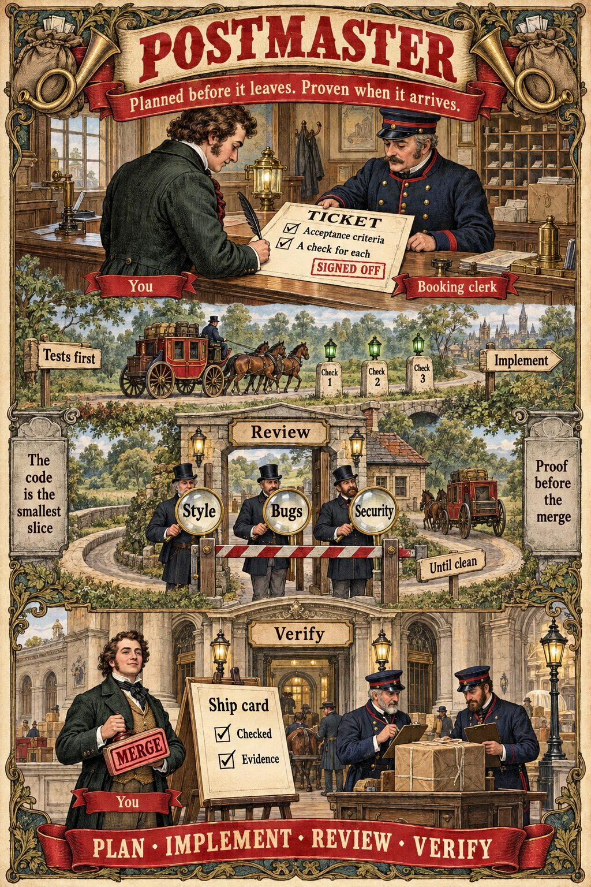
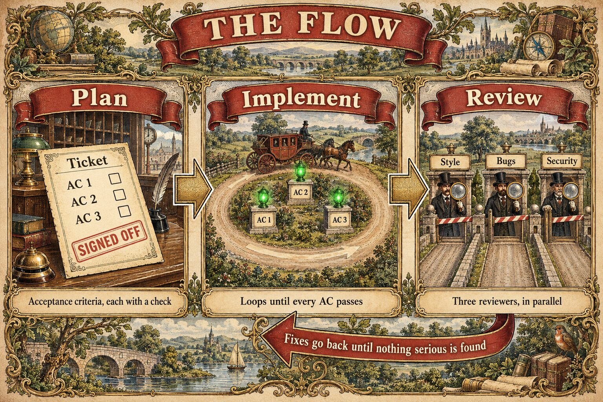
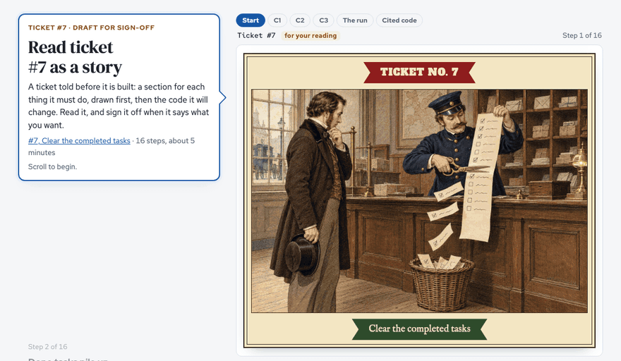
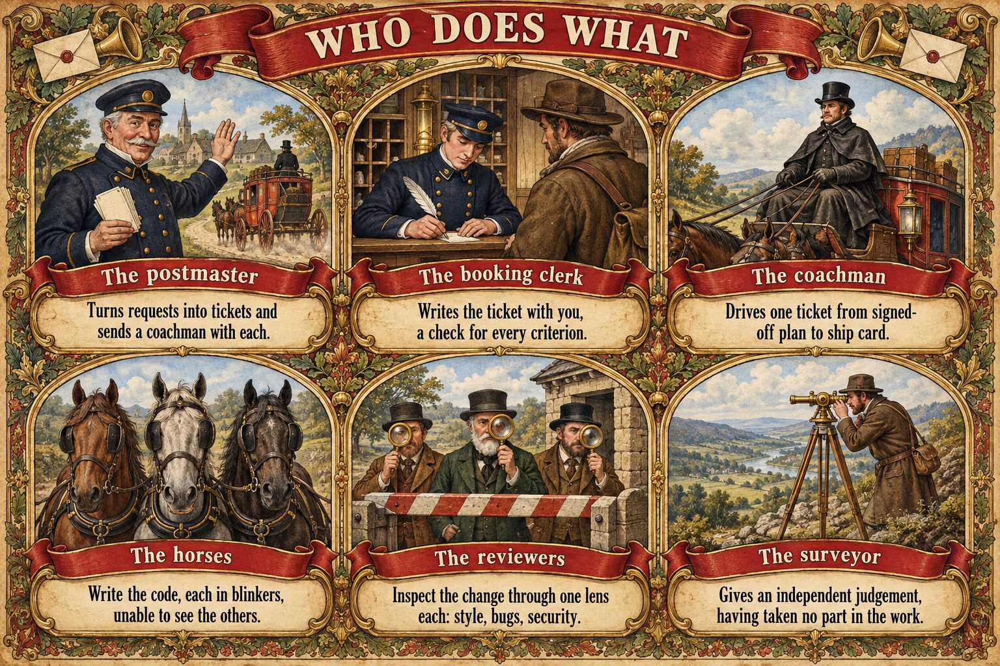

# postmaster

> TL;DR: clone the repo, open your agent in it (Claude is recommended), and say hi.

Inspired by Anthropic's [AI-native SDLC playbook](https://claude.com/resources/articles/the-ai-native-sdlc-playbook) and pstack's verification skills, [create-verification-skill](https://github.com/cursor/plugins/blob/23e4138daa01c42d4969f7a5465f82704e64f798/pstack/skills/create-verification-skill/SKILL.md) and [maintain-verification-skill](https://github.com/cursor/plugins/blob/23e4138daa01c42d4969f7a5465f82704e64f798/pstack/skills/maintain-verification-skill/SKILL.md).

Postmaster takes a ticket and brings back a reviewed, verified change, with the evidence that it works. Most of its effort goes into two places: deciding exactly what to build before any code is written, and proving that it works once the code is there. Writing the code is the smallest slice.

  

## The idea

Anthropic's [AI-native SDLC playbook](https://claude.com/resources/articles/the-ai-native-sdlc-playbook) makes the case that code is no longer the bottleneck. The work moves to the steps on either side of the build: planning before it, and review and testing after it. Postmaster is built to match. [What the wiki takes from the playbook](wiki/sources/ai-native-sdlc-playbook.md).

A design goal of postmaster is not to give you a complete solution. It is to let you run experiments on different flows, so that you can find what works for your project.

## The flow

1. Plan. The booking clerk, an agent, works with you on the ticket until it has acceptance criteria and, for each one, a check that shows it is met: a command, a test, or a walk through the running app. You read the ticket once and sign it off. Nothing starts before that. A run may add a library only if the ticket lists it, the clerk has vetted it and you have said yes.
2. Implement. The acceptance tests are written from the ticket's checks and committed before any of the change. The implementer then loops until every check passes. A check that cannot pass as written is not edited to fit; it comes back to you.
3. Review. Reviewers read the change through the lenses the ticket names: style, bugs and security by default. They report what they find, the implementer fixes it, and they look again. The loop ends when a round finds nothing serious, and smaller findings are listed for you instead of looped on. If a round finds more serious problems than the one before, or the same kind of problem keeps coming back, the loop stops and brings you what is left.
4. Verify and land. The project's checks run on the final commit, and the verifiers drive the running app the way a user would. A check that could not run counts as not run, never as a pass. The ship card lists what was checked and the evidence for it, and it comes to you. You merge a pull request yourself; postmaster never does. Without a pull request, the change lands on main on your merge word, unless your config gives that word to the postmaster.

The reasoning behind each step is in the wiki: [the ticket](wiki/concepts/ticket-shape.md), [the review loop](wiki/concepts/review-loop.md) and [verification](wiki/concepts/verification.md).

## Ticket and code reviews, told as a story

With Claude Code, postmaster can publish a ticket, or a finished change, as one scrolling page made for a phone. Each acceptance criterion gets a section: the ticket's words, a drawing, then the code, with the lines the step is about lit. You read a ticket's story before you sign it off, and a change's story when you review it. Changed lines that no step shows are listed at the end, so nothing is hidden. The pages are private to you on claude.ai.

## Who does what

  

Each role is an agent CLI running a model. The config says which fills each role, and whether one model writes the change or several. [Why several models](docs/why-several-models.md). [The roles in full](docs/roles.md).

## Built on things you may know

| In postmaster | You may know it from |
|---|---|
| The ticket, signed off before any code | The spec in spec-driven development, as in [GitHub Spec Kit](https://github.com/github/spec-kit) or [Kiro](https://kiro.dev) |
| Acceptance tests that fail first and pass once the change is in | Test-driven development |
| Verifiers | [pstack](https://github.com/cursor/plugins/tree/23e4138daa01c42d4969f7a5465f82704e64f798/pstack)'s [`create-verification-skill`](https://github.com/cursor/plugins/blob/23e4138daa01c42d4969f7a5465f82704e64f798/pstack/skills/create-verification-skill/SKILL.md) and [`maintain-verification-skill`](https://github.com/cursor/plugins/blob/23e4138daa01c42d4969f7a5465f82704e64f798/pstack/skills/maintain-verification-skill/SKILL.md) |
| Lanes | The agent CLIs you already run: Claude Code, Codex, Grok, Antigravity, pi, Muse Code and MiMo Code |
| Several models on one ticket, each in its own git worktree | Cursor's [`/best-of-n`](https://cursor.com/docs/configuration/worktrees), except that the coachman combines what each got right instead of picking one |
| The review loop | Review bots such as CodeRabbit, in a loop with the implementer |
| Ticket and code stories | Scrollytelling, from long-form journalism: the panel follows the step you are reading |
| Tickets | GitHub Issues on a GitHub Projects board, the default |

## Verifiers

Setting up a project offers to make its verifiers with [pstack](https://github.com/cursor/plugins/tree/23e4138daa01c42d4969f7a5465f82704e64f798/pstack)'s skills. A verifier is a small folder that tells an agent arriving cold how to start one surface of the project, drive it the way a user does, and keep proof. The clerk writes a ticket's checks through a verifier wherever a criterion drives that surface, and after a change lands postmaster checks whether any verifier has gone stale and offers to bring it up to date. [More about verifiers](docs/verifiers.md).

## It leaves no trace

Apart from the change it lands, postmaster leaves nothing in your project. Its records, drafts and verifiers sit in a `.postmaster` folder whose contents git ignores, its worktrees are listed in git's own exclude file, and tickets kept locally live inside the repository's git folder. A project it has worked on looks exactly like one it has not. Settings your team should share are committed only when you choose to. [The .postmaster folder](docs/project-settings.md).

## Everything is recorded

Every action is logged as it happens, and every run can be traced from ticket to merge. What the project has learned lives in the [wiki](wiki/index.md), where each claim cites the recorded runs behind it.

## Getting started

Clone this repo, open your agent in it, and say hi. Any first message starts the flow, and `AGENTS.md` tells the agent what to do, so there is no command to learn. There are two ways to start: say hi in a session in the postmaster project, or run the postmaster command in a session already in the project you want to work on. Either way the first question is which project to work on: postmaster itself or another. Setup then asks one question at a time (which agents fill which role, where tickets live, who gives the merge word), and the postmaster starts. The first start in a new folder may ask whether to trust it.

The rest is in short pages:

- [Getting started, with every command](docs/getting-started.md)
- [The .postmaster folder and project settings](docs/project-settings.md)
- [What it needs, and notes for macOS](docs/requirements.md)
- [Installing the skills, tickets and project configuration](docs/installing-skills.md)
- [Native sessions](docs/native-sessions.md)
- [Design principles](docs/design-principles.md)
- [Records and the wiki](docs/records-and-the-wiki.md)

See `AGENTS.md` for the full context, and `skills/postmaster/` for the runbooks and adapters.
